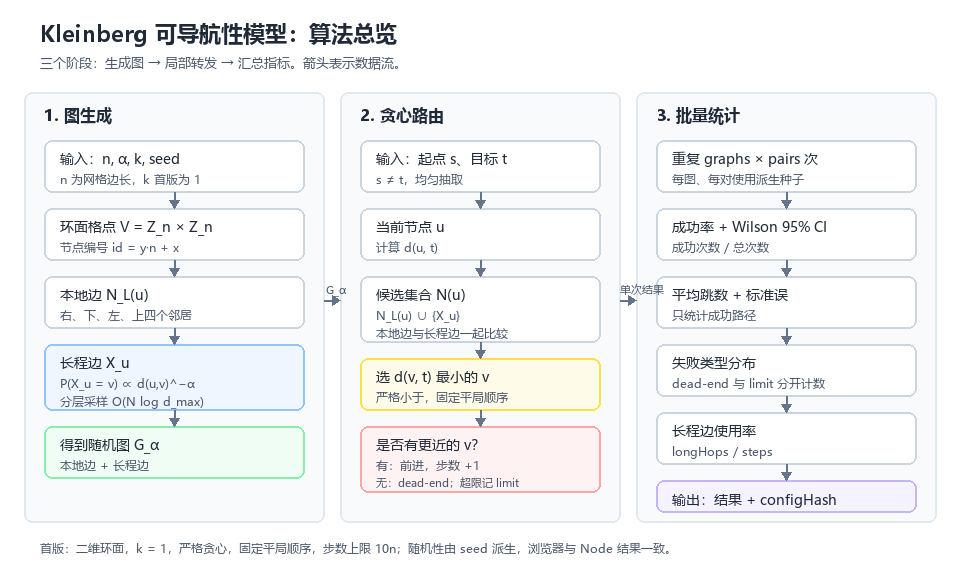
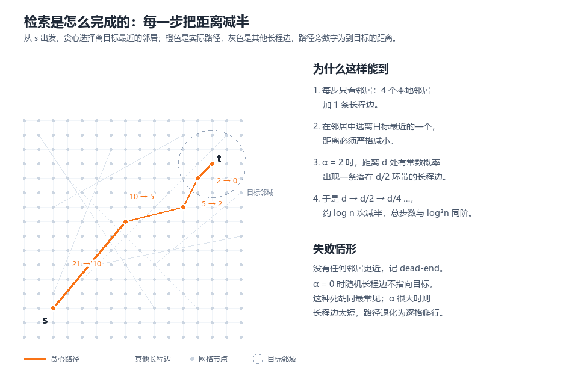

# Theory：Kleinberg 可导航性模型的算法描述

本文档定义项目实现所依据的模型、算法与实验口径。所有实现、实验脚本与前端展示都必须与本文档一致。文档中的符号在代码中一一对应。

## 总览

模型由三段组成，数据从左向右流动。



矢量源为同目录的 `overview.svg`，位图由 `scripts/make_overview.py` 生成。



从起点 s 出发，每一步用一条长程边把到目标的距离减半，最后用本地步到达。灰色细线是网络中其他长程边，它们不指向目标，因此不会被选中；路径旁的数字是当前节点到目标的距离。位图由 `scripts/make_routing_figure.py` 生成。

**图生成**：在 n×n 环面格点上放置四个本地邻居；每个节点再独立抽取一条长程边，目标按距离的 −α 次幂分布。长程边用按距离分层的方式采样，避免逐点枚举和低接受率的拒绝采样，最终得到随机图 G_α。

**路由**：给定起点 s 与目标 t，每一步在当前节点的本地邻居与长程边中，选到目标距离最小的节点前进；若没有任何邻居更近，判死胡同；步数超过 10n 判超限；到达目标则成功。全过程只使用当前节点的邻居与目标坐标。

**统计**：对 graphs 张图、每图 pairs 对源目标重复上述过程，汇总成功率与 Wilson 区间、成功路径平均跳数、失败类型分布、长程边使用率；结果连同配置与 configHash 一起输出。

## 1. 模型定位

本模型研究的问题是：在一个只掌握局部信息的网络中，逐跳转发能否高效到达目标。

模型属于小世界网络家族，但与 Watts–Strogatz 模型不同：底层不是任意图，而是规则的 d 维格点；长程边不是均匀随机重连，而是按两端距离的幂律分布抽取。Watts–Strogatz 模型可作为本模型在 `α = 0` 时的参数点，不单独实现代码路径。

首版固定二维环面、每节点一条长程边、严格贪心路由。

## 2. 符号

| 符号 | 含义 |
|---|---|
| `n` | 网格边长，节点总数 `N = n²` |
| `V` | 节点集合，`V = Z_n × Z_n` |
| `u, v, s, t` | 节点；`s` 为起点，`t` 为目标 |
| `d(u,v)` | 环面曼哈顿距离 |
| `N_L(u)` | `u` 的四个本地邻居 |
| `X_u` | `u` 的长程边目标 |
| `k` | 每个节点的长程边数量，首版为 1 |
| `α` | 长程边距离分布的指数 |
| `L` | 路由步数上限，取 `10n` |
| `G_α` | 由 `n` 与 `α` 确定的随机图 |

节点编号采用行优先：`id = y · n + x`，其中 `x, y ∈ {0, …, n−1}`。

## 3. 空间与距离

节点坐标按模 `n` 计算，网格边界首尾相接。横向与纵向的环面差分别为

```
Δx(a,b) = min(|x_a − x_b|, n − |x_a − x_b|)
Δy(a,b) = min(|y_a − y_b|, n − |y_a − y_b|)
d(a,b)  = Δx(a,b) + Δy(a,b)
```

距离取值范围为 `0 … 2·floor(n/2)`。`d(a,b) = 0` 当且仅当 `a = b`。

## 4. 图生成

### 4.1 本地边

每个节点 `u = (x, y)` 与下列四个节点相连，坐标均对 `n` 取模：

```
(x+1, y), (x−1, y), (x, y+1), (x, y−1)
```

本地边双向，路由时按无向边处理。

### 4.2 长程边

每个节点独立抽取 `k` 条有向长程边。首版 `k = 1`，记 `u` 的长程边目标为 `X_u`。对 `v ≠ u`，

```
P(X_u = v) = c_u · d(u,v)^(−α)
c_u = 1 / Σ_{w ≠ u} d(u,w)^(−α)
```

`X_u` 与 `X_v` 相互独立，允许出现 `X_u = v` 且 `X_v = u`，也允许长程边指向本地邻居。路由时只使用 `u` 的出边 `X_u`，因此长程边按有向边处理。

### 4.3 采样算法

直接按 `P(X_u = v)` 逐点采样需要枚举 `N−1` 个候选，代价过高；拒绝采样在 `α` 较大时长边接受率过低。实现采用按距离分层采样：

1. 预计算距离分布 `count[d] = |{v : d(u,v) = d}|`。环面平移不变，任意 `u` 的分布相同。
2. 计算权重 `w[d] = count[d] · d^(−α)`，并做前缀和 `C[d]`。
3. 抽取 `r ∈ [0, C[d_max])`，二分查找满足 `C[d−1] ≤ r < C[d]` 的距离 `d`。
4. 在距离恰为 `d` 的节点表中均匀抽取一个节点，再按 `u` 平移得到 `X_u`。

距离层表以原点为参考预计算：`layers[d]` 存放所有满足 `d(0, v) = d` 的 `v`。对 `u = (x_u, y_u)`，平移后的目标为

```
X_u = ((x_v + x_u) mod n, (y_v + y_u) mod n)
```

该采样与逐点分布严格等价，复杂度为 `O(N log d_max)` 建表加 `O(N log d_max)` 采样。

### 4.4 随机源

所有随机性来自带种子的伪随机数生成器。每张图使用 `hash(seed, 'graph', graphIndex)` 派生的种子；每对源目标使用 `hash(seed, 'pair', pairIndex)` 派生的种子，与图无关，因此不同图复用同一组源目标对，构成配对设计。禁止使用无种子随机源，禁止依赖调用顺序。

## 5. 路由

### 5.1 规则

给定 `G_α`、起点 `s`、目标 `t`，执行严格贪心：

```
u ← s
steps ← 0
longHops ← 0
path ← [s]

while u ≠ t and steps < L:
    du ← d(u, t)
    best ← none
    bestD ← du
    for v in N_L(u)，按固定顺序 (右, 下, 左, 上):
        if d(v, t) < bestD:
            best ← v; bestD ← d(v, t); bestIsLong ← false
    for j in 0 … k−1:
        v ← X_u[j]
        if d(v, t) < bestD:
            best ← v; bestD ← d(v, t); bestIsLong ← true
    if best = none:
        return (failure = dead-end, steps, path)
    u ← best
    steps ← steps + 1
    if bestIsLong: longHops ← longHops + 1
    path.append(u)

if u = t:
    return (success, steps, path, longHops)
else:
    return (failure = limit, steps, path, longHops)
```

### 5.2 平局与确定性

比较使用严格小于 `<`。本地邻居先于长程边检查，本地邻居按“右、下、左、上”的固定顺序。这样同一张图、同一对源目标的结果完全确定。

随机平局只作为敏感性检验的独立配置，不进入主实验。

### 5.3 失败类型与一个结构性质

- `dead-end`：当前节点的所有邻居到目标的距离都不小于当前距离。
- `limit`：步数达到 `10n` 仍未到达目标。
- `none`：成功到达。

**命题**：在二维环面上，只要 `u ≠ t`，横向差与纵向差之和必大于 0；沿任一非零的坐标轴走一步，该轴距离严格减小，因此四个本地邻居中至少有一个更近。严格贪心每步都能前进，路径不会成环，步数不超过 `2·floor(n/2)`，`dead-end` 与 `limit` 都不会发生。

**推论**：标准模型下成功率恒为 1。失败计数只用于发现实现错误，不能作为主指标；可发现性的差异体现在跳数，不在能否到达。要得到真实的失败，必须在模型外加入信息缺失、有限耐心或拒绝转发等机制。

失败不计入平均跳数，只计入失败率与失败类型分布。

## 6. 观测量

单次路由返回：`success`、`steps`、`path`、`failure`、`longHops`。

批量实验聚合以下量：

| 观测量 | 定义 |
|---|---|
| 成功率 | 成功次数 / 总次数 |
| 成功路径平均跳数 | 成功样本的 `steps` 均值 |
| 跳数标准误 | 成功样本标准差 / √成功样本数 |
| 死胡同率 | `dead-end` 次数 / 总次数 |
| 超限率 | `limit` 次数 / 总次数 |
| 长程边使用率 | 成功样本的 `longHops` 总和 / `steps` 总和 |
| 最短路 | 同一批源目标对的 BFS 跳数 `ℓ(s,t)` 均值，由全局信息求得，只作对照 |
| 效率比 | 成功样本的 `steps / ℓ(s,t)` 均值，必须与成功率同时报告，避免只统计成功样本造成的选择偏差 |

## 7. 实验协议

一次实验由配置 `ExperimentConfig` 确定：

```
n, α, k, graphs, pairsPerGraph, seed, stepLimitFactor
```

执行流程：

1. 对 `graphIndex = 0 … graphs−1`，用派生种子生成一张 `G_α`。
2. 对 `pairIndex = 0 … pairsPerGraph−1`，独立均匀抽取 `s` 与 `t`，若 `s = t` 则重抽。
3. 对每对 `(s, t)` 执行一次路由，记录结果；同时对同一对做一次 BFS 求最短跳数 `ℓ(s,t)`，BFS 使用全局信息，只用于效率比对照，不参与路由。
4. 汇总全部 `graphs × pairsPerGraph` 次路由，计算第 6 节的观测量。

主实验的默认网格：

- `n ∈ {16, 32, 48, 64, 80, 96, 112, 128}`，从 16 开始每隔 16 一档
- `α ∈ {0, 0.5, 1, 1.25, 1.5, 1.75, 2, 2.25, 2.5, 3}`
- `k = 1`
- `graphs = 50`，`pairsPerGraph = 100`
- `stepLimitFactor = 10`

规模扩展档，用于定位交叉点与最优点的移动：

- `n ∈ {256, 512, 1024, 2048}`，`α ∈ {0, 0.5, 1, 1.25, 1.5, 1.75, 2}`
- `graphs = 8`，`pairsPerGraph = 50`
- 只报步数与最短路；失败计数在这一档只用于确认实现无误

稳健性配置：`k = 2`，`n ∈ {32, 64, 96, 128}`，其余相同。

## 8. 统计与判定

- 成功率区间用 Wilson 得分区间，置信水平 95%；本模型下该区间恒覆盖 1，只作健全性检查。
- 跳数均值报告标准误，效率比 `T/ℓ` 报告均值。
- 最优点 `α*` 定义为平均跳数最小的 `α`，用二次拟合取顶点，并对图与源目标对做自助法给出 95% 区间。
- 主判定一（标度）：`α = 2` 的平均跳数与 `log²n` 同阶，`α = 0` 与 `n^{2/3}` 同阶；`n` 从 128 增到 2048 时前者约增 3 倍，后者约增 7 倍。
- 主判定二（交叉）：存在规模 `n_c`，当 `n > n_c` 时 `T(α=2) < T(α=0)`，且比值随 `n` 单调下降。
- 辅助判定：`α*` 随 `n` 增大整体右移；`n ≤ 128` 时 `α* ≤ 1.25`，`n ≥ 1024` 时 `α* ≥ 1.5`。

## 9. 可复现性

- 伪随机数生成器采用 mulberry32。
- 每个实验记录 `seed`、完整配置与 `configHash`。
- 浏览器与 Node 脚本共用同一核心模块，同一配置必须给出同一结果。
- 论文图表由脚本读取批量结果生成，不手工改数。

## 10. 复杂度

| 步骤 | 复杂度 |
|---|---|
| 距离层预计算 | `O(N)` |
| 单张图生成长程边 | `O(N log d_max)` |
| 单次路由 | `O(T · (4 + k))`，`T` 为实际步数 |
| 一次批量实验 | `O(graphs · (N log d_max + pairs · T · (4 + k)))` |

`n = 128` 时 `N = 16384`，`graphs = 50` 的单次建图开销可接受；`n = 256` 时 `N = 65536`，仅在时间允许时运行。

## 11. 与文献的对应

- Kleinberg (2000) 证明：二维格点、`k = 1`、`α = 2` 时，贪心路由的期望步数为 `O(log² n)`；`α ≠ 2` 时为多项式下界。
- `α = 0` 时长程边目标均匀分布，等价于不携带距离信息的随机长程边，可作为 Watts–Strogatz 模型的对照。
- Clauset & Moore (2003) 指出有限规模下最优指数偏离 2，且随规模收敛很慢；本实验的 `n` 网格用于观察这一偏差。
- Dodds, Muhamad & Watts (2003) 的真实转发实验完成率低，说明短路径存在不等于可被发现；本实验的失败类型统计对应该区分。

## 12. 首版范围与待定项

首版实现：

- 二维环面，`k = 1`，严格贪心，固定平局顺序。
- 均匀抽取源目标，`s ≠ t`。
- 失败类型二分：`dead-end` 与 `limit`。
- 实验与前端共用核心模块。

待定项：

- `k = 2` 的稳健性配置。
- 随机平局的敏感性检验。
- `n = 256` 的性能与结果。
- 层次模型只进入论文对比表，不进入代码。
